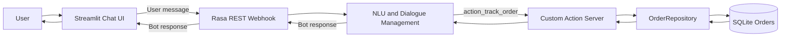

# E-commerce FAQ & Order Tracking Bot

An e-commerce conversational assistant built with Rasa Open Source. It answers common store questions and guides shoppers through order tracking, combining intent recognition, multi-turn dialogue management, Python custom actions, and a SQLite data layer. A lightweight Streamlit interface connects to the assistant through Rasa's REST webhook.

## Key Features

- Answers frequently asked questions, including the store's return policy.
- Recognizes natural-language order tracking requests.
- Extracts, validates, and normalizes order IDs.
- Requests an order number when the shopper has not provided one and continues the tracking flow when it arrives.
- Uses Rasa custom actions and a separate SQLite repository for order lookups.
- Responds safely to malformed or unknown IDs and database errors.
- Routes recognized unrelated requests to a concise out-of-scope reply and uses Rasa's NLU fallback for low-confidence or ambiguous predictions.
- Provides a Streamlit chat interface with message history and REST connection error handling.
- Includes automated unit tests for action behavior, SQLite repository lookups, and REST client errors.
- Separates conversation configuration, action logic, data access, and the chat interface into focused files.

## Why Rasa?

Rasa provides practical building blocks for this assistant: intent classification and entity extraction to interpret messages; a domain to define intents, entities, slots, responses, and actions; and rule-based and story-based policies to represent multi-turn conversations. Custom actions connect those conversations to Python logic and the SQLite repository. The REST channel lets an external interface such as Streamlit exchange messages with the assistant.

The project uses Rasa's local pipeline and dialogue components as a small, extendable implementation. The NLU pipeline includes Rasa 3.6's `FallbackClassifier` with a 0.99 confidence threshold and 0.1 ambiguity threshold. The high threshold is deliberate: this small DIET model can assign high confidence to unrelated text. Messages classified as `out_of_scope` receive a short reply that points back to returns and order tracking; low-confidence or ambiguous predictions receive the same guidance through `nlu_fallback`. These behaviors depend on the trained model and the coverage of its examples; they do not guarantee correct classification for every message.

## Tech Stack

| Technology | Use |
| --- | --- |
| Python | Custom actions, repository, and demo client |
| Rasa Open Source 3.6.21 | NLU and dialogue management |
| Rasa SDK 3.6.2 | Custom action server |
| SQLite | Fictional local order records |
| Streamlit | Browser-based chat interface |
| Rasa REST API | Message transport between Streamlit and Rasa |
| `unittest` | Unit and client behavior tests |

## Architecture



## Example Conversation

The order below is fictional sample data from the local SQLite database.

```text
User: Hi!
Assistant: Hello! How can I help you with your order or a store question today?

User: Can you track my order?
Assistant: Sure, I can check that. What is your order number?

User: ORD-10482
Assistant: Order ORD-10482 is shipped. Estimated delivery: 2026-10-16.
```

## Installation and Local Setup

Rasa Open Source 3.6.21 is pinned in `requirements.txt`. Use Python 3.10 for this setup.

### 1. Create the environment and install dependencies

In PowerShell, from the project directory:

```powershell
conda create -n rasa310 python=3.10.13 -y
conda activate rasa310
python -m pip install -r requirements.txt
```

### 2. Initialize the fictional order database

```powershell
python scripts/init_db.py
```

This creates 15 sample orders in `data/orders.sqlite3`. The initializer can be rerun to initialize the schema and refresh the sample records. To use a different SQLite file, set the same `ORDER_DB_PATH` environment variable in the initializer and action server terminals. The default is `data/orders.sqlite3`, relative to the project directory.

```powershell
$env:ORDER_DB_PATH = "data/local-orders.sqlite3"
python scripts/init_db.py
```

### 3. Validate, test, and train

```powershell
rasa data validate
python -m unittest discover -s tests -v
rasa train
```

To evaluate the dialogue model against the Rasa conversation test stories after training:

```powershell
rasa test core --stories tests/test_conversations.yml --out results
```

### 4. Start the local services

Open three PowerShell terminals in the project directory and activate the `rasa310` environment in each. If you configured a non-default `ORDER_DB_PATH`, set it in the action-server terminal as well.

**Terminal 1 — custom action server:**

```powershell
rasa run actions
```

**Terminal 2 — Rasa server with REST enabled:**

```powershell
rasa run --enable-api --credentials credentials.yml --endpoints endpoints.yml --port 5005
```

`credentials.yml` enables the `rest:` input channel and contains no credentials. The Streamlit client calls `http://localhost:5005/webhooks/rest/webhook`. Set `RASA_REST_URL` if the Rasa server uses another base URL or webhook URL.

**Terminal 3 — Streamlit interface:**

```powershell
streamlit run streamlit_app.py
```

Open the local URL printed by Streamlit, usually **http://localhost:8501**.

## Testing

Run the unit suite and Rasa data validation with:

```powershell
python -m unittest discover -s tests -v
rasa data validate
```

The action tests verify valid and invalid order IDs, known and unknown orders, missing slot values, and safe database error handling. Repository tests use isolated temporary SQLite databases. REST client tests cover successful replies, connection failures, HTTP errors, and malformed responses. `tests/test_nlu.yml` evaluates unrelated text and each supported intent against the trained model. `tests/test_rasa_model.py` loads the latest trained model and checks the exact unusual-help regression through NLU parsing and the full Rasa Agent response path, plus unrelated questions and supported intent responses. `tests/test_conversations.yml` defines additional dialogue scenarios for order tracking, including missing and unknown order IDs. After training, run `python -m unittest discover -s tests -v`, `rasa test nlu --nlu tests/test_nlu.yml`, and `rasa test core --stories tests/test_conversations.yml`. A confidence threshold cannot guarantee correct intent classification for every possible message; these tests cover representative cases, not all user language.

## Project Structure

```text
.
├── actions.py                 # Form validation and order tracking action
├── order_repository.py        # SQLite data access
├── streamlit_app.py           # Chat interface
├── rasa_rest_client.py        # REST webhook client
├── config.yml, domain.yml     # NLU pipeline, policies, intents, slots, responses
├── credentials.yml            # REST channel configuration
├── endpoints.yml              # Custom action endpoint
├── data/                      # NLU examples, stories, rules, local database
├── scripts/init_db.py         # Creates and seeds fictional orders
└── tests/                     # Unit tests and Rasa conversation scenarios
```

## Limitations and Future Improvements

- The SQLite orders and delivery estimates are fictional demo data.
- There is no connection to a real e-commerce platform, order service, or shipping provider.
- The project is configured for local development and is not a deployed production service.
- The NLU examples and fallback behavior have limited coverage; broader labeled data and evaluation are needed to understand classification quality across user language.
- Future work could connect a real order service, broaden fallback examples and evaluation, and prepare a deployment appropriate to the target environment.
